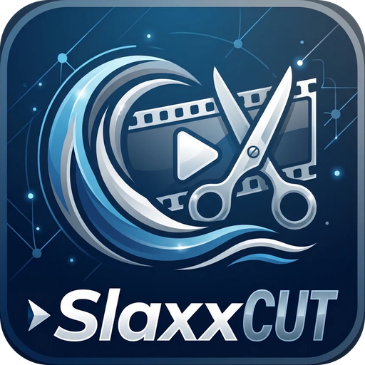

<p align="center"></p>

<h1 align="center">SlaxxCUT</h1>
<p align="center"><b>Modernes Videoschnittprogramm · Modern video editor</b><br>macOS (Apple Silicon) · Windows · Linux (AppImage)<br><i>Done by IT-DUMMKOPFEN</i></p>

---

## 🇩🇪 Deutsch

### Download
Die fertigen Programme findest du unter **[Releases](https://github.com/IT-DUMMKOPFEN/SlaxxCUT/releases)**:

| System | Datei |
|---|---|
| macOS (Apple Silicon M1–M4) | `SlaxxCUT-x.y.z-macOS-AppleSilicon.dmg` |
| Windows | `SlaxxCUT-x.y.z-Windows-Setup.exe` (Installer) oder `…-Portable.exe` |
| Linux | `SlaxxCUT-x.y.z-Linux-x86_64.AppImage` |

**macOS:** DMG öffnen, SlaxxCUT in „Programme“ ziehen. Weil die App nicht von Apple notarisiert ist, einmalig im Terminal:
```
xattr -cr /Applications/SlaxxCUT.app
```
**Linux:** `chmod +x SlaxxCUT-*.AppImage` und starten (ggf. wird `libfuse2` benötigt).

### Funktionen
- **Oberfläche:** links Medien / Effekte / Übergänge (Reiter), Mitte Quellvorschau, rechts Schnitt-Vorschau, darunter Werkzeugleiste und Timeline
- **Import** per Knopf oder Drag & Drop: Video (MP4, MOV, MKV, AVI, WebM …), Audio (MP3, WAV, FLAC, AAC, OGG …), Bilder (JPG, PNG, WebP, HEIC …) – nicht direkt abspielbare Formate bekommen automatisch eine Vorschau-Datei (Proxy)
- **Timeline** mit bis zu 10 Spuren (+/−), Magnet/Einrasten (abschaltbar), Zoom per **mittlerer Maustaste + hoch/runter**, Strg/⌘ + Mausrad oder Trackpad-Pinch
- Schneiden, Trimmen, Klinge, Löschen mit Lückenschluss, Kopieren/Einfügen, Rückgängig/Wiederholen
- **Ein-/Ausblenden** direkt am Clip (Anfasser oben links/rechts) für Bild und Ton
- **Effekte:** Zoom In/Out, Pan & Scan, Kamerawackeln, Parallax, Zeitlupe, Zeitraffer · Schwarz-Weiß, Sepia, Vintage, Film Look, Color Grading (+ LUT), Duotone, HDR-Look · Ton trennen, Lauter, Leiser, Angleichen, Einheitliche Lautstärke · Text einblenden (Schrift, Farbe, Größe, Schatten, Kontur, Box)
- **Übergänge** für Video, Bild und Ton: Ein-/Ausblenden, Überblendung, Wischen, Zoom, Drehen, Glitch, Whip Pan
- **Export** als MP4 (H.264/AAC): 4K, 2K, 1080p, 720p, 480p, 360p · 16:9, 9:16, 1:1 · Qualitätsstufen · Grafikkarten-Beschleunigung (VideoToolbox/NVENC/QSV/AMF) · Lautheits-Normalisierung
- Deutsch & Englisch, Tag- und Nachtmodus in den Logo-Farben, Tooltips nach 2 s, Hilfe (DE/EN), Info-Seite mit allen Lizenzen, automatische Sicherung

### Selbst bauen
```
npm install
npm start            # starten
npm run dist:mac     # bzw. dist:win / dist:linux
```
Die GitHub-Action `.github/workflows/build.yml` baut bei jedem Tag `v*` alle drei Versionen und legt sie als Release ab.

---

## 🇬🇧 English

### Download
Get the ready-to-run programs from **[Releases](https://github.com/IT-DUMMKOPFEN/SlaxxCUT/releases)** (macOS Apple Silicon DMG, Windows installer/portable EXE, Linux AppImage).

**macOS:** open the DMG and drag SlaxxCUT to “Applications”. The app isn't notarized by Apple, so run once in Terminal: `xattr -cr /Applications/SlaxxCUT.app`
**Linux:** `chmod +x SlaxxCUT-*.AppImage` and start it (some systems need `libfuse2`).

### Features
Three-tab media/effects/transitions panel, source and edit previews, toolbar, timeline with up to 10 tracks, snapping, middle-mouse/pinch zoom, fades on clips, motion/color/audio/text effects, transitions, MP4 export from 360p to 4K in 16:9, 9:16 and 1:1 with hardware acceleration, German/English UI, day/night mode, 2-second tooltips, built-in help and license page.

### Build
```
npm install && npm start
```

---

### Lizenz / License
SlaxxCUT is free software under the **GNU GPL v3.0 or later** (see `LICENSE`).
Bundled: FFmpeg via `ffmpeg-static` (GPL), Electron (MIT), fonts Inter, Montserrat, Roboto, Anton, Archivo Black, Bitter, Crimson Text, Comic Relief (SIL OFL 1.1, see `licenses/`).

*Geschrieben von IT-DUMMKOPFEN mit Hilfe einer KI. · Written by IT-DUMMKOPFEN with the help of an AI.*
